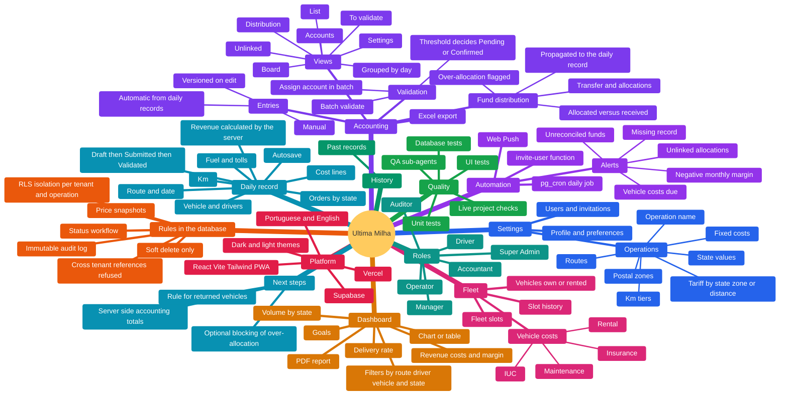
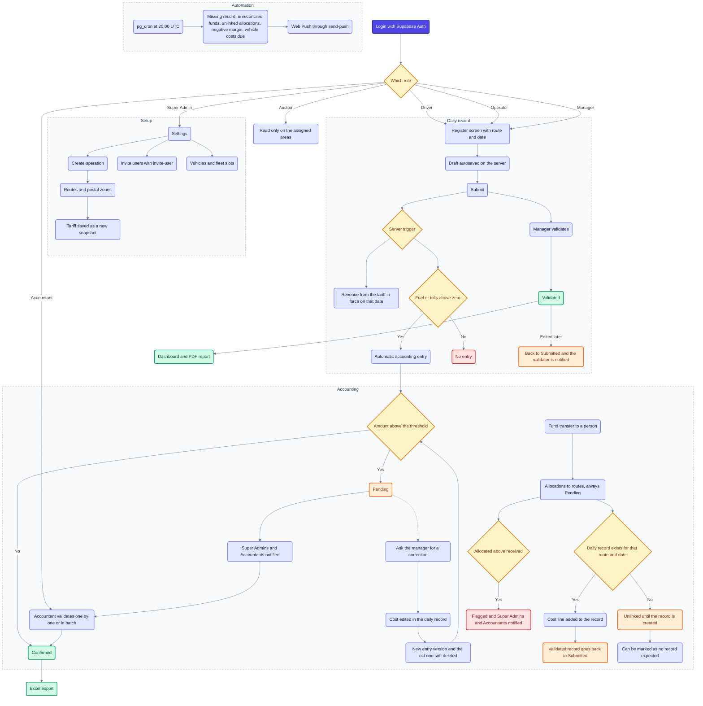

# Architecture

This document explains how Última Milha is built and why. It is written from the code in this repository (migrations, Edge Functions, tests and `src/`).

## Map

Everything the app contains, by area.



## Flow from start to end

The main path through the app, with its branches. Blue is a step, yellow a decision, green a good end state, orange a state that needs attention, red a blocked or flagged case.



## 1. What the system does

A multi-tenant, mobile-first PWA to run last-mile delivery operations. A company (tenant) has operations, each operation has routes, and each route has one daily record per day with volumes, kilometres and costs. Revenue is calculated from the route tariff, costs feed an accounting module, and the system raises alerts when something needs attention.

## 2. Big picture

```
 Browser (React PWA)
   |  supabase-js (user JWT)
   v
 Supabase
   |-- Auth ................ users, sessions, invitations
   |-- Postgres ............ tables, RLS policies, triggers, RPC functions
   |-- Edge Functions ...... invite-user, send-push (Deno)
   |-- pg_cron ............. daily alert job (20:00 UTC)
   '-- pg_net .............. database -> Edge Function call for push
```

There is no separate application server. The business rules live in the database, so every client (the app, a script, a test) is bound by the same rules.

## 3. Where the rules live and why

Rules that must always be true are enforced in Postgres, not in the UI:

| Rule | Mechanism |
|---|---|
| Data isolation per operation and tenant | Row Level Security policies on every table |
| Nothing is physically deleted | `DELETE` revoked, `forbid_delete` trigger, soft delete with `deleted_at` |
| Immutable history | `audit_log` is append-only (`audit_immutable` trigger), `tariff_snapshots` are immutable |
| Revenue is computed on the server | `records_before` trigger calls `compute_revenue` |
| Status workflow (Draft, Submitted, Validated) | `records_before` trigger rejects invalid transitions |
| Fields only the server may write | Triggers overwrite or reject them (`validado_por`, `created_by`, accounting `origem`) |
| Cross-tenant references are refused | `movements_refs` and `records_refs` triggers |

The UI hides what a role cannot do, but it is never the only protection. The tests call the database directly as each role to prove this.

## 4. Data model (main tables)

- **Tenancy and access:** `tenants`, `profiles`, `user_roles`, `user_operations`, `invitations`. Roles: super admin, manager, operator, driver, accountant, auditor.
- **Operations:** `operations`, `routes`, `postal_zones`, `tariff_snapshots`.
- **Daily work:** `daily_records` (one per route and date), `daily_record_costs`.
- **Fleet:** `vehicles`, `drivers`, `fleet_slots`, `slot_assignments`.
- **Accounting:** `movements`, `bank_accounts`, `accounting_settings`.
- **System:** `notifications`, `push_subscriptions`, `audit_log`, `goals`.

Vehicles and drivers are shared at tenant level, while routes and records are isolated per operation. This split is a deliberate decision.

## 5. Price integrity

A route's tariff is stored as versioned snapshots (`tariff_snapshots`, ordered by `valid_from`). When a daily record is saved, the `records_before` trigger picks the latest snapshot in force on the record date, computes revenue with `compute_revenue`, and stores the result and the snapshot date on the record. Changing a tariff creates a new snapshot and never recalculates existing records, so history stays correct. km tiers are progressive (price per slice of km).

## 6. Daily record workflow

A record moves Draft, Submitted, Validated. Only a manager or super admin can validate. A Submitted or Validated record can never return to Draft. Editing a Validated record sends it back to Submitted and notifies whoever validated it. Drafts are saved automatically, and the only required fields are route and date.

## 7. Accounting

- Entries are created automatically from a daily record (fuel and tolls) once it leaves Draft, or manually.
- The server decides the initial state: above a configurable threshold the entry is Pending, otherwise Confirmed. Fund allocations are always Pending.
- Editing a cost creates a new version of the entry (`versao_anterior_id`) instead of updating it, and only the latest active version counts in totals.
- Fund distribution: a transfer plus child allocations. Over-allocation is not blocked but it is flagged on the server (a view and a notification).
- Allocations are propagated to the daily record of the same route and date when it exists, or stay "unlinked" and attach later. Concurrent linking cannot duplicate a cost line (partial unique index).

## 8. Notifications and scheduled jobs

- `app.notify` inserts a notification with a deduplication key, so the same alert is never sent twice to the same user.
- An `after insert` trigger on `notifications` calls the `send-push` Edge Function through `pg_net`. A push failure never blocks the notification.
- `pg_cron` runs `app.run_alerts()` daily at 20:00 UTC: missing records, unreconciled funds, unlinked allocations, negative monthly margin and vehicle costs due.

## 9. Edge Functions (Deno)

- **`invite-user`:** creates the invitation as the inviting user, so the database permission matrix applies, and only then sends the email with the service role.
- **`send-push`:** receives the call from the database (protected by a shared secret header), builds the message in the recipient's language, and sends Web Push. Expired subscriptions are removed.

## 10. Frontend

React, TypeScript and Vite, with TanStack Query for data, react-router for navigation, react-i18next for Portuguese and English, and Tailwind CSS 4 with design tokens. It is a PWA (service worker, Web Push). Route guards use the user's roles for navigation, but authorization is enforced by the database.

## 11. Performance decisions

- RLS policies call functions without row arguments as `(select ...)`, so Postgres evaluates them once and not per row. This turned slow queries (seconds) into milliseconds on large tables.
- A partial index (`movements_active_order`) supports ordering the active accounting entries.
- PostgREST returns at most 1000 rows per request, so the app pages through results up to a cap, and shows a warning when the cap is reached.
- Long lists render 100 cards at a time.

## 12. Testing and verification

| Layer | What it checks |
|---|---|
| Database tests (PGlite, real Postgres) | Business rules, role permissions, RLS isolation, audit trail, alerts, accounting versioning |
| Unit tests (Vitest) | Calculations, pagination, role access, translations |
| UI tests (headless Chrome) | Key flows per role |
| Checks against a live Supabase project | End to end behaviour on the real stack |
| QA scripts in `qa/` | Scenarios run by test sub-agents against a project you provide |

## 13. How it was built

Developed with agentic AI coding (Claude Code). The project rules in `CLAUDE.md` and the test suites act as the specification and the safety net: the rules are written down, and the tests verify them after each change.

## 14. Known limitations and next steps

- Accounting aggregation happens in the client up to a row cap. Moving it to the server is the planned improvement.
- Over-allocation is flagged, not blocked. Blocking only needs an exception in `app.movements_overalloc()`.
- Currency is EUR only in this version.
- Whether a returned vehicle frees its slot is still undecided.
